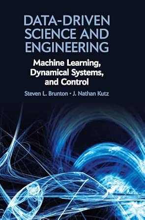

## University of Utah SIAM Student Chapter Data-Driven Modeling Discussion Group

### Target Audience:
- Motivated undergraduate students in math, engineering, computer science, etc.
- Early graduate students in similar fields

### Goals:
- Create a GitHub account
- Learn basic Git commands
- Set up a coding/development enviroment
- Learn Python through applied math examples
- Learn about Data-Driven modeling from Brunton and Kutz's book [Data-Driven Science and Engineering](https://databookuw.com/)
- See coded examples and implement them yourself!

### Schedule
Each session's notebooks and notes are in a folder named by its date. The talk schedule is also posted on our SIAM Student Chapter [webpage](https://www.math.utah.edu/siamsc/).

| Date | Topic | Folder |
|---|---|---|
| 10/21/26 | Setting up Git, VS Code and Python, and a brief introduction to Python | [10_21_26](10_21_26) |
| 11/11/26 | The SVD and PCA: compressing data and finding patterns (Chapter 1) | [11_11_26](11_11_26) |

### The book:

